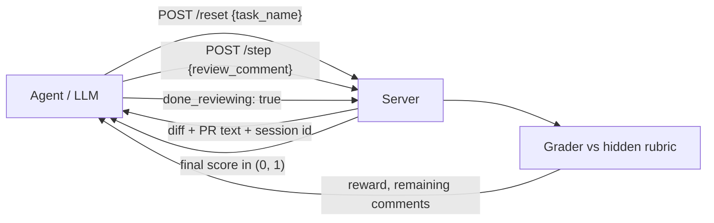

# PR Review Gym


An [OpenEnv](https://github.com/openenv/OpenEnv)-compatible reinforcement-learning environment in which an AI agent plays a **code reviewer**. Each episode hands the agent a pull-request diff (plus title and description); the agent leaves review comments one at a time and is scored by a deterministic grader against a hidden, hand-labelled rubric of real defects: bugs, security holes, performance traps, logic errors and style problems.

LLMs are increasingly used as review assistants, but there are few interactive, objectively scored benchmarks for them. The grader awards partial credit for near-misses on line position, rewards correct severity and category, and penalises false positives. That gives a dense, bounded reward signal you can use both to evaluate LLM reviewers and to train agents with RL.

> Formerly published as `code-review-env`. Some internal identifiers still use the old name (the `openenv.yaml` `name`, the Python package name `openenv-code-review-env`, the `CodeReviewEnv` class).

## Features

- **12 review scenarios** in three difficulty tiers (Python and JavaScript), each with planted, line-labelled defects: billing code, Flask upload handlers, an XSS-prone profile page, an SSRF-prone webhook fetcher, a pandas ETL pipeline, and more.
- **Rubric grader** with keyword and synonym matching, line-proximity tiers, severity weighting, category/severity bonuses, an escalating false-positive penalty and a coverage bonus.
- **Per-step rewards**: the step reward is the increase in episode score, so the agent gets paid exactly when it finds something new.
- **Session-aware HTTP API** (FastAPI): `POST /reset`, `POST /step` and `GET /state` keyed by an `X-OpenEnv-Session-Id` header, plus `/tasks`, `/health`, `/docs` and the OpenEnv WebSocket route `/ws`. Sessions live in a TTL cache with sliding expiry, a size cap and a per-session lock.
- **In-process use**: the core environment has no server dependencies, so you can drive it directly from Python.
- **Baselines**: a fixed-seed random policy (`baseline.py`) and a prompted LLM reviewer (`inference.py`) that works with any OpenAI-compatible API.
- **Deployment**: a Dockerfile (non-root user, health check, port 8000) and Hugging Face Space front matter (the YAML block at the top of this file).
- **55 offline test cases** (pytest) covering the environment, grader, scenario integrity, cache, HTTP API and inference helpers.

## Tech stack

Python 3.10+, FastAPI + Uvicorn, Pydantic v2, `openenv-core`, OpenAI Python SDK (LLM baseline only), pytest + httpx, Docker, uv (lockfile).

## Project structure

```text
pr-review-gym/
├── server/
│   ├── app.py             # FastAPI app: session-aware /reset, /step, /state, plus / and /tasks
│   ├── cache.py           # TTL cache used to expire idle HTTP sessions
│   ├── openenv_env.py     # OpenEnv Environment adapter (HTTP / WebSocket / clients)
│   ├── env.py             # Core state machine: reset, step, caps, duplicates, truncation
│   ├── grader.py          # Rubric scoring: keywords, synonyms, line tolerance, penalties
│   ├── tasks.py           # 12 scenarios: diffs, PR text, labelled expected issues; task aliases
│   └── models.py          # Pydantic models for actions, observations, state, results
├── tests/                 # pytest suite (env, grader, tasks, cache, HTTP API, inference helpers)
├── baseline.py            # Deterministic random-action baseline (no network)
├── inference.py           # LLM reviewer agent (OpenAI-compatible API)
├── openenv.yaml           # OpenEnv metadata: tasks, spaces, reward range, entry point
├── Dockerfile             # python:3.11-slim, non-root, port 8000, health check
├── pyproject.toml         # Package metadata, `server` console script, dev extras
├── requirements.txt       # Runtime dependencies
├── uv.lock                # Locked dependency versions for uv
└── LICENSE                # MIT
```

## Getting started

### Prerequisites

- Python **3.10 or newer** (`requires-python = ">=3.10"`; the Docker image uses 3.11)
- Git
- Optional: Docker, [uv](https://github.com/astral-sh/uv), and an API key for an OpenAI-compatible LLM endpoint (only needed for `inference.py`)

### Install

```bash
git clone https://github.com/geethatigulla/pr-review-gym.git
cd pr-review-gym
python -m venv .venv
source .venv/bin/activate          # Windows PowerShell: .venv\Scripts\Activate.ps1
pip install -e ".[dev]"            # runtime deps + pytest and httpx
```

Alternatives: `uv sync --extra dev` installs the exact locked versions from `uv.lock`; `pip install -r requirements.txt` installs only the runtime dependencies.

### Configuration

All variables are optional except the API key, which only `inference.py` needs.

| Variable | Default | Used by | Purpose |
|----------|---------|---------|---------|
| `PORT` | `7860` | `python -m server.app` / `server` | Server port (ignored when you call `uvicorn` directly). |
| `SESSION_TTL_SEC` | `1800` | server | Idle lifetime of an HTTP session in seconds (refreshed on every call). |
| `MAX_SESSIONS` | `1000` | server | Cap on live sessions; those closest to expiry are evicted first. |
| `HF_TOKEN` / `API_KEY` | none | `inference.py` | API key for the LLM endpoint (`HF_TOKEN` takes precedence). Required for `inference.py`. |
| `API_BASE_URL` | `https://router.huggingface.co/v1` | `inference.py` | OpenAI-compatible base URL. |
| `MODEL_NAME` | `Qwen/Qwen2.5-72B-Instruct` | `inference.py` | Model to use. |
| `MIN_SUBMIT_CONFIDENCE` | `0` (off) | `inference.py` | Re-query comments whose self-reported confidence is below this value. |
| `IMAGE_NAME` | unset | `inference.py` | Run against this Docker image (via `GenericEnvClient.from_docker_image`) instead of in-process. |

Never commit real API tokens. If one is exposed, revoke it at [Hugging Face access tokens](https://huggingface.co/settings/tokens).

### Run the tests

```bash
pytest
```

Tests run offline; no API keys are needed.

### Start the server

```bash
uvicorn server.app:app --host 0.0.0.0 --port 7860
# or: python -m server.app      (reads PORT, default 7860)
# or: server                    (console script installed by pip install -e .)
```

Open http://localhost:7860/docs for the Swagger UI, or http://localhost:7860/health.

### Play an episode over HTTP

```bash
# 1) Start an episode and capture the session id from the response header
SID=$(curl -s -D - -o /dev/null -X POST localhost:7860/reset \
  -H 'content-type: application/json' \
  -d '{"task_name": "easy", "seed": 1, "scenario_index": 0}' \
  | grep -i x-openenv-session-id | cut -d' ' -f2 | tr -d '\r')

# 2) Submit a review comment
curl -s -X POST localhost:7860/step \
  -H "X-OpenEnv-Session-Id: $SID" -H 'content-type: application/json' \
  -d '{"action": {"review_comment": {"line_number": 4, "comment": "off-by-one: range stop len(items)+1 raises IndexError", "severity": "critical", "category": "bug"}}}'

# 3) Finish the review and read the final state (total_reward is the score)
curl -s -X POST localhost:7860/step \
  -H "X-OpenEnv-Session-Id: $SID" -H 'content-type: application/json' \
  -d '{"action": {"done_reviewing": true}}'
curl -s localhost:7860/state -H "X-OpenEnv-Session-Id: $SID"
```

Error codes: **400** for an unknown `task_name` or a missing session header on `/step`; **404** for an unknown or expired session; **422** for an invalid action (for example, an unsupported `severity`).

### Use the environment from Python (no server)

```python
from server.env import CodeReviewEnv
from server.models import CodeReviewAction, ReviewComment

env = CodeReviewEnv()
obs = env.reset(task_name="easy", seed=1, scenario_index=0).observation
print(obs.pr_title)
print(obs.diff)

result = env.step(CodeReviewAction(review_comment=ReviewComment(
    line_number=4,
    comment="off-by-one: range stop len(items)+1 raises IndexError",
    severity="critical",
    category="bug",
)))
print("step reward:", result.reward)

env.step(CodeReviewAction(done_reviewing=True))
print("final score:", env.state().total_reward)
```

### Run the baselines

```bash
python baseline.py        # random policy, fixed seeds, no network

export HF_TOKEN="your-token-here"   # or API_KEY
python inference.py       # LLM reviewer; one episode per task
```

`inference.py` prints `[START]`, `[STEP]` and `[END]` lines per task, followed by a `[SUMMARY]`. On PowerShell, set variables with `$env:HF_TOKEN = "..."`.

### Docker

```bash
docker build -t pr-review-gym .
docker run -p 8000:8000 pr-review-gym            # server on http://localhost:8000
docker run --rm pr-review-gym python baseline.py
```

The container listens on port **8000**, the port OpenEnv's `LocalDockerProvider` expects.

### OpenEnv validation and Hugging Face Spaces

```bash
openenv validate                                  # static checks on the repository
openenv validate --url http://localhost:7860      # live checks against a running server
```

The front matter at the top of this README sets up a Docker Space (`sdk: docker`, `app_port: 8000`). Push the repository to a Space and it builds and serves the environment.

## How it works



1. **Reset.** The agent picks a task (`easy`, `medium` or `hard`). The environment samples one of that task's four scenarios, or a fixed one if you pass `seed` or `scenario_index`.
2. **Review.** Each step submits one comment: `line_number`, `comment`, `severity` (`critical | major | minor | suggestion`) and `category` (`bug | security | performance | style | logic`).
3. **Grade.** The grader re-scores all comments so far against the hidden rubric. The step reward is the non-negative increase in score. A second comment on an already-commented line earns nothing and returns a feedback hint.
4. **Finish.** The episode ends on `done_reviewing: true`, after **10** accepted comments, or after **30** steps (then `truncated` is `true`).

Layering: `app.py` → `cache.py` + `openenv_env.py` (OpenEnv adapter) → `env.py` (state machine) → `grader.py`, `tasks.py`, `models.py`. OpenEnv's stock HTTP routes create a new environment per request, so `app.py` replaces them with session-keyed routes. The WebSocket route is left unchanged.

### Tasks

| Task id | Focus | Scenarios |
|---------|-------|-----------|
| `easy` | Obvious bugs: off-by-one, wrong variable, missing guard, mutating while iterating | `bug-offbyone`, `bug-wrongvar`, `bug-js-array`, `bug-dict-mutation` |
| `medium` | Security: SQL injection, hard-coded secrets, path traversal, XSS, SSRF, unsafe YAML, disabled TLS | `sec-sqli`, `sec-pathtraversal`, `sec-js-xss`, `sec-ssrf` |
| `hard` | Full review mixing security, logic, performance and style in larger diffs | `comp-orderservice`, `comp-inventoryapi`, `comp-js-ecommerce`, `comp-data-pipeline` |

Legacy aliases are still accepted: `find-bugs` → `easy`, `security-review` → `medium`, `comprehensive-review` → `hard`.

### Observation and action

Canonical types are in [`server/models.py`](server/models.py); a schema summary is in [`openenv.yaml`](openenv.yaml).

Observation fields: `task_name`, `diff`, `file_name`, `language`, `pr_title`, `pr_description`, `comments_so_far`, `remaining_comments`, `step_feedback`, `truncated`, plus `reward` and `done` in HTTP/OpenEnv responses.

```json
{
  "review_comment": {
    "line_number": 4,
    "comment": "Explain the problem and how to fix it",
    "severity": "critical | major | minor | suggestion",
    "category": "bug | security | performance | style | logic"
  },
  "done_reviewing": false
}
```

To end the review, send `{"done_reviewing": true}` with no comment.

### Reward design (`server/grader.py`)

| Component | Rule |
|-----------|------|
| Match | A comment matches an issue if it contains one of the issue's keywords or a phrase from its synonym group. Each issue matches at most once (greedy best match). |
| Line proximity | Within ±4 lines: base 0.6, +0.2 for the correct category, +0.2 for the correct severity. Within ±8: the same minus 0.1. Farther away: 0.3 (+0.1 for the correct category). |
| Severity weighting | Issue points × weight: critical 1.5, major 1.0, minor 0.5, suggestion 0.25. |
| False positives | First unmatched comment −0.05, each further one −0.10. |
| Coverage bonus | +0.15 when every issue in the scenario is found. |
| Normalisation | `(points − penalty) / max_points`, clamped and mapped strictly inside `(0, 1)`, because OpenEnv validators reject the exact endpoints. |

`info` also reports `rl_reward` (the raw, possibly negative, step delta), `sub_score_1` (weighted recall) and `sub_score_2` (false-positive cleanliness).

### Baseline scores

| Agent | `easy` | `medium` | `hard` |
|-------|--------|----------|--------|
| Random policy (`baseline.py`, fixed seeds) | 0.0001 | 0.0001 | 0.0001 |
| Qwen2.5-72B-Instruct (`inference.py`), approximate | ~0.55 | ~0.45 | ~0.30 |

These are the author's reported numbers. The LLM figures come from single-episode runs and vary with the scenario drawn, the model version and the temperature. For stable comparisons, run many seeds and report mean ± std.

## Limitations and future work

- Matching is keyword/synonym-based, so a correct comment phrased in unexpected words can score as a false positive. Semantic matching (embeddings or an LLM judge) is a natural next step.
- Only 12 single-file scenarios in two languages. More languages (Go, Java, TypeScript) and multi-file diffs are planned.
- Sessions are held in process memory, so they don't survive restarts and aren't shared across replicas.
- Other ideas: multi-turn author responses, and a leaderboard with multi-seed evaluation.

## License

[MIT](LICENSE)
