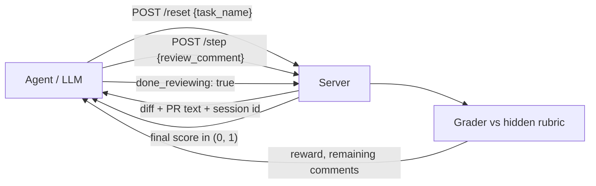
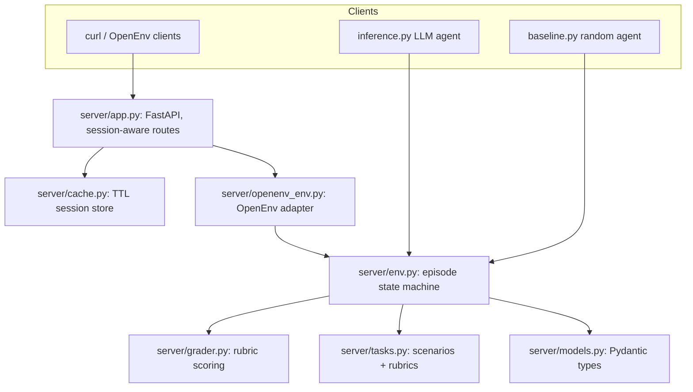

# PR Review Gym — a Code Review Environment for OpenEnv


A reinforcement-learning environment in which an AI agent plays the role of a **code reviewer**. Each episode hands the agent a pull-request diff; the agent leaves review comments one at a time and is scored against a hidden answer key of real defects — bugs, security holes, performance traps, logic errors and style problems.

---

## Table of contents

1. [Abstract](#abstract)
2. [Objectives](#objectives)
3. [What the project does](#what-the-project-does)
4. [How it works](#how-it-works)
5. [How we built it](#how-we-built-it)
6. [How to run the project](#how-to-run-the-project)
7. [Tasks and difficulty](#tasks-and-difficulty)
8. [Action and observation spaces](#action-and-observation-spaces)
9. [Reward design](#reward-design)
10. [Configuration](#configuration)
11. [Baseline scores](#baseline-scores)
12. [Project structure](#project-structure)
13. [Future work](#future-work)
14. [License](#license)

---

## Abstract

Code review is one of the most common — and most time-consuming — activities in software engineering. It blends language understanding, domain knowledge (security, performance, correctness) and precise, structured feedback tied to specific lines of code. Large language models are increasingly used as review assistants, but there are few **interactive, objectively scored** benchmarks for measuring how good they really are at it.

This project provides such a benchmark as an **[OpenEnv](https://github.com/openenv/OpenEnv)-compatible RL environment**. An agent is shown a realistic pull request (a unified diff plus a title and description) and must surface the issues it contains by submitting review comments with a line number, an explanation, a severity and a category. A deterministic grader compares those comments to a hand-labelled rubric and awards **partial credit** for near-misses in line position, rewards correct severity and category, and **penalises false positives**. The result is a dense, bounded reward signal suitable for both **evaluating** LLM reviewers and **training** agents with reinforcement learning.

The environment ships with 12 scenarios across three difficulty tiers (Python and JavaScript), an HTTP/WebSocket server that can be deployed with Docker or as a Hugging Face Space, a deterministic random baseline, an LLM baseline agent, and a 55-test suite.

## Objectives

1. **Measure review quality objectively.** Replace subjective “does this review look good?” judgements with a reproducible score based on recall of known defects and precision (few false positives).
2. **Provide a learnable signal.** Give per-step rewards that rise as the agent finds new issues, so RL algorithms receive feedback during the episode instead of only at the end.
3. **Reward the behaviours a good reviewer shows:** finding the most severe problems, pointing at the right line, labelling the issue correctly, and not flooding the author with noise.
4. **Cover a realistic spread of difficulty**, from obvious bugs in a short helper file to multi-concern reviews mixing security, logic, performance and style.
5. **Be easy to adopt.** Follow the OpenEnv interface (`reset` / `step` / `state`), validate with `openenv validate`, and run locally, in Docker, or as a hosted Space with no code changes.
6. **Stay reproducible.** Seeded scenario sampling, fixed-seed baselines and an offline test suite make results repeatable.

## What the project does

| You get | Description |
|---------|-------------|
| **Environment** | A stateful review episode: diff in, comments out, reward back. |
| **12 scenarios** | Synthetic but realistic PRs: billing code, Flask upload handlers, a JWT-in-localStorage frontend, an SSRF-prone webhook, a pandas ETL pipeline, and more. |
| **Grader** | Keyword + synonym matching, line-proximity tiers, severity weighting, false-positive penalties. |
| **HTTP / WebSocket server** | FastAPI app with session-aware `POST /reset`, `POST /step`, `GET /state`, plus `/tasks`, `/health`, `/docs` and `/ws`. |
| **Baselines** | A fixed-seed random policy (`baseline.py`) and an LLM reviewer (`inference.py`) using any OpenAI-compatible API. |
| **Deployment** | Dockerfile (non-root, health-checked) and Hugging Face Space front matter. |

## How it works



1. **Reset.** The agent picks a task (`easy`, `medium` or `hard`). The environment samples one scenario from that pool (or a fixed one if `seed` / `scenario_index` is given) and returns the diff, file name, language, PR title and description.
2. **Review.** On each step the agent submits one comment: `line_number`, `comment`, `severity` (`critical | major | minor | suggestion`) and `category` (`bug | security | performance | style | logic`).
3. **Grade.** The grader re-scores all comments so far against the hidden rubric. The step reward is the *increase* in score, so the agent is paid exactly when it finds something new.
4. **Finish.** The episode ends when the agent sends `done_reviewing: true`, uses all **10** comments, or exhausts the **30**-step budget (then `truncated` is `true`). The final score is the grader’s total for the episode.

**Worked example** (easy task, scenario 0):

```python
def get_last_items(items, n):
    result = []
    for i in range(len(items) - n, len(items) + 1):   # line 4
        result.append(items[i])
```

A comment on line 4 saying *“off-by-one: the range stop `len(items) + 1` raises IndexError”* with severity `critical` and category `bug` matches the rubric fully. The same comment on line 10 earns reduced credit, and an unrelated remark counts as a false positive.

## How we built it

**Tech stack:** Python 3.10+, FastAPI + Uvicorn, Pydantic v2, `openenv-core`, the OpenAI Python SDK (for the LLM baseline), pytest, Docker, and uv for locked installs.

The system is built in layers, each one depending only on the layers beneath it:



1. **Data model first** (`server/models.py`). We defined the action, observation and state as Pydantic models so every message is validated. For example, an invalid severity is rejected with HTTP 422 before it reaches the environment.
2. **Scenario authoring** (`server/tasks.py`). Each scenario is a short, self-contained file with intentionally planted defects. Each defect is labelled with its line number, category, severity, matching keywords and a synonym group. A test checks that every label points at a real line of its diff.
3. **Grader** (`server/grader.py`). We wanted partial credit rather than exact-match scoring, so the grader:
   - accepts any of an issue’s keywords or synonym phrases (so “ZeroDivisionError”, “divide by zero” and “empty list” all count);
   - gives full credit within ±4 lines, partial credit within ±8, and a small amount for the right idea on the wrong line;
   - adds bonuses for the correct category and severity, and weights issues by severity (`critical` 1.5 → `suggestion` 0.25);
   - subtracts an escalating false-positive penalty and adds a bonus for finding every issue.

   Scores are mapped strictly inside `(0, 1)` because OpenEnv validators reject the exact endpoints.
4. **Environment** (`server/env.py`). A plain Python state machine handles reset/step, comment and step caps, duplicate-line feedback and truncation. Because it has no server dependencies, the baselines and tests run it in-process with no network.
5. **OpenEnv adapter** (`server/openenv_env.py`). This wraps the environment in OpenEnv’s `Environment` interface so it works with `create_fastapi_app`, the WebSocket transport and `GenericEnvClient`.
6. **Server** (`server/app.py`). OpenEnv’s stock HTTP routes are stateless: they create a new environment per request. We replaced `/reset`, `/step` and `/state` with routes keyed by an `X-OpenEnv-Session-Id` header, so a multi-step episode works over plain HTTP:
   - sessions live in a TTL cache with sliding expiry and a size cap;
   - each session has a lock so concurrent requests can’t corrupt it;
   - bad input gets a clear 400, 404 or 422 instead of a 500.
7. **Baselines.**
   - `baseline.py` sends benign random comments to confirm a non-reviewer scores near zero.
   - `inference.py` is a prompted LLM reviewer. It numbers the diff’s lines, avoids repeating itself, can gate on self-reported confidence, and logs every step.
8. **Quality and packaging.** 55 offline tests cover the environment, grader, scenarios, cache, HTTP API and baseline helpers. `openenv validate` passes both against the repository and against a running server. The Docker image runs as a non-root user with a `/health` check.

## How to run the project

### 1. Prerequisites

- **Python 3.10 or newer** (`python --version`)
- **Git**
- *Optional:* Docker, uv, and an API key for an OpenAI-compatible LLM endpoint (only needed for `inference.py`)

### 2. Clone and install

```bash
git clone https://github.com/geethatigulla/pr-review-gym.git
cd pr-review-gym
python -m venv .venv
```

Activate the virtual environment:

```bash
# macOS / Linux
source .venv/bin/activate
```

```powershell
# Windows (PowerShell)
.venv\Scripts\Activate.ps1
```

Install the project with its development extras (adds pytest and httpx):

```bash
pip install -e ".[dev]"
```

> Prefer uv? `uv sync --extra dev` installs the exact locked versions from `uv.lock`. Only need the runtime? `pip install -r requirements.txt`.

### 3. Run the tests

```bash
pytest
```

You should see `55 passed`. No network access or API keys are required.

### 4. Start the server

```bash
uvicorn server.app:app --host 0.0.0.0 --port 7860
```

Then open **http://localhost:7860/docs** for the interactive Swagger UI, or check **http://localhost:7860/health**. You can also start the server with `python -m server.app`, which reads the `PORT` environment variable.

### 5. Play an episode over HTTP

In a second terminal (bash, Git Bash or WSL):

```bash
# 1) Start an episode and capture the session id from the response header
SID=$(curl -s -D - -o /dev/null -X POST localhost:7860/reset \
  -H 'content-type: application/json' \
  -d '{"task_name": "easy", "seed": 1, "scenario_index": 0}' \
  | grep -i x-openenv-session-id | cut -d' ' -f2 | tr -d '\r')
echo "session: $SID"

# 2) Submit a review comment
curl -s -X POST localhost:7860/step \
  -H "X-OpenEnv-Session-Id: $SID" -H 'content-type: application/json' \
  -d '{"action": {"review_comment": {"line_number": 4, "comment": "off-by-one: range stop len(items)+1 raises IndexError", "severity": "critical", "category": "bug"}}}'

# 3) Finish the review and read the final state (total_reward is the score)
curl -s -X POST localhost:7860/step \
  -H "X-OpenEnv-Session-Id: $SID" -H 'content-type: application/json' \
  -d '{"action": {"done_reviewing": true}}'
curl -s localhost:7860/state -H "X-OpenEnv-Session-Id: $SID"
```

Error codes:
- **400:** unknown `task_name`, or the session header is missing.
- **404:** unknown or expired session.
- **422:** invalid action, such as an unsupported `severity`.

### 6. Use the environment directly from Python (no server)

```python
from server.env import CodeReviewEnv
from server.models import CodeReviewAction, ReviewComment

env = CodeReviewEnv()
obs = env.reset(task_name="easy", seed=1, scenario_index=0).observation
print(obs.pr_title)
print(obs.diff)

result = env.step(CodeReviewAction(review_comment=ReviewComment(
    line_number=4,
    comment="off-by-one: range stop len(items)+1 raises IndexError",
    severity="critical",
    category="bug",
)))
print("step reward:", result.reward)

env.step(CodeReviewAction(done_reviewing=True))
print("final score:", env.state().total_reward)
```

### 7. Run the baselines

**Random baseline:** deterministic, needs no API key. It should score close to zero on every task.

```bash
python baseline.py
```

**LLM reviewer:** uses any OpenAI-compatible endpoint. The default is the Hugging Face router with Qwen2.5-72B-Instruct.

```bash
export HF_TOKEN="your-token-here"          # or API_KEY
export API_BASE_URL="https://router.huggingface.co/v1"
export MODEL_NAME="Qwen/Qwen2.5-72B-Instruct"
python inference.py
```

On Windows PowerShell, set the variables with `$env:HF_TOKEN = "your-token-here"` (and likewise for the others). It runs one episode per task and prints `[START]`, `[STEP]` and `[END]` lines followed by a `[SUMMARY]`. Optional settings:
- `MIN_SUBMIT_CONFIDENCE=0.5` re-queries comments the model is unsure of.
- `IMAGE_NAME=<docker image>` runs against a Docker container instead of in-process.

> **Token safety:** never commit real API tokens or paste them into repository files. If a token is exposed, revoke it at [Hugging Face access tokens](https://huggingface.co/settings/tokens) and create a new one.

### 8. Run with Docker

```bash
docker build -t pr-review-gym .
docker run -p 8000:8000 pr-review-gym            # server on http://localhost:8000
docker run --rm pr-review-gym python baseline.py
```

The image listens on port **8000**, the port OpenEnv’s `LocalDockerProvider` expects.

### 9. Validate OpenEnv compliance

```bash
openenv validate                                  # static checks on the repository
openenv validate --url http://localhost:7860      # live checks against a running server
```

### 10. Deploy as a Hugging Face Space

The YAML front matter at the top of this README configures a Docker Space (`sdk: docker`, `app_port: 8000`). Push the repository to a new Space and it will build and serve the environment automatically.

## Tasks and difficulty

Each task id selects a **pool of four scenarios**. Unless you pass `seed` or `scenario_index`, one is sampled at random on every `reset`.

| Task id | Difficulty | Focus | Example scenarios |
|---------|------------|-------|-------------------|
| `easy` | Easy | Obvious bugs: off-by-one, wrong variable, missing guard, mutating while iterating | list helpers, billing totals, JS array utils, TTL cache |
| `medium` | Medium | Security: SQL injection, hard-coded secrets, path traversal, XSS, SSRF, unsafe YAML, disabled TLS | auth service, Flask file server, profile page, webhook fetcher |
| `hard` | Hard | Full review mixing security, logic, performance and style in larger diffs | order service, inventory API, e-commerce checkout, ETL pipeline |

Legacy aliases still work: `find-bugs` → `easy`, `security-review` → `medium`, `comprehensive-review` → `hard`.

## Action and observation spaces

Canonical Pydantic types live in [`server/models.py`](server/models.py); a schema summary is in [`openenv.yaml`](openenv.yaml).

### Observation

| Field | Type | Meaning |
|-------|------|---------|
| `task_name` | string | Active task (`easy`, `medium`, `hard`). |
| `diff` | string | Code under review (constant within an episode). |
| `file_name` | string | Path of the changed file. |
| `language` | string | `python` or `javascript`. |
| `pr_title` / `pr_description` | string | PR context. |
| `comments_so_far` | array | Comments accepted so far this episode. |
| `remaining_comments` | integer | Comments left before the cap of 10. |
| `step_feedback` | string or null | Hints such as duplicate-line warnings. |
| `truncated` | boolean | `true` if the episode ended on the step budget. |
| `reward`, `done` | number, boolean | Step reward and terminal flag (HTTP / OpenEnv responses). |

### Action

```json
{
  "review_comment": {
    "line_number": 4,
    "comment": "Explain the problem and how to fix it",
    "severity": "critical | major | minor | suggestion",
    "category": "bug | security | performance | style | logic"
  },
  "done_reviewing": false
}
```

Send `{"done_reviewing": true}` (with no comment) to end the review.

## Reward design

Scoring lives in [`server/grader.py`](server/grader.py).

| Component | Rule |
|-----------|------|
| **Match** | A comment matches an issue if it contains one of the issue’s keywords or synonym-group phrases. Each issue can be matched at most once (greedy best match). |
| **Line proximity** | ±4 lines → full credit (0.6 base); ±8 → base − 0.1; farther → 0.3 for the right idea on the wrong line. |
| **Metadata bonus** | +0.2 for the correct category, +0.2 for the correct severity (only when the line is close). |
| **Severity weighting** | Issue points × weight: critical 1.5, major 1.0, minor 0.5, suggestion 0.25. |
| **False positives** | First unmatched comment −0.05, each further one −0.10. |
| **Coverage bonus** | +0.15 when every issue in the scenario is found. |
| **Normalisation** | `(points − penalty) / max_points`, clamped and mapped strictly inside `(0, 1)`. |
| **Step reward** | Non-negative increase in the episode score; duplicates earn nothing (`info["rl_reward"]` shows the raw −0.05). |

Two diagnostic sub-scores are also reported in `info`:
- `sub_score_1`: weighted recall.
- `sub_score_2`: false-positive cleanliness, where higher means fewer false positives.

## Configuration

| Variable | Default | Used by | Purpose |
|----------|---------|---------|---------|
| `PORT` | `7860` | `python -m server.app` | Server port. |
| `SESSION_TTL_SEC` | `1800` | server | Idle lifetime of an HTTP session (refreshed on every call). |
| `MAX_SESSIONS` | `1000` | server | Cap on live sessions; those closest to expiry are evicted first. |
| `HF_TOKEN` / `API_KEY` | — | `inference.py` | API key for the LLM endpoint. |
| `API_BASE_URL` | HF router | `inference.py` | OpenAI-compatible base URL. |
| `MODEL_NAME` | `Qwen/Qwen2.5-72B-Instruct` | `inference.py` | Model to use. |
| `MIN_SUBMIT_CONFIDENCE` | `0` (off) | `inference.py` | Minimum self-reported confidence before a comment is submitted. |
| `IMAGE_NAME` | unset | `inference.py` | Run against this Docker image instead of in-process. |

## Baseline scores

| Agent | `easy` | `medium` | `hard` |
|-------|--------|----------|--------|
| Random policy (`baseline.py`, fixed seeds) | 0.0001 | 0.0001 | 0.0001 |
| Qwen2.5-72B-Instruct (`inference.py`, approx.) | ~0.55 | ~0.45 | ~0.30 |

The LLM numbers are approximate single-episode results from earlier runs. Because `reset` samples a random scenario, they vary with the scenario drawn, the model version and the temperature. For stable reporting, run many seeds and report mean ± standard deviation.

## Project structure

```text
pr-review-gym/
├── server/
│   ├── app.py             # FastAPI app: session-aware /reset, /step, /state + /tasks
│   ├── cache.py           # TTL cache used to expire idle HTTP sessions
│   ├── openenv_env.py     # OpenEnv Environment adapter (HTTP / WebSocket / clients)
│   ├── env.py             # Core state machine: reset, step, caps, duplicates, truncation
│   ├── grader.py          # Rubric scoring: keywords, synonyms, line tolerance, penalties
│   ├── tasks.py           # 12 scenarios: diffs, PR text, labelled expected issues
│   └── models.py          # Pydantic models for actions, observations, state, results
├── tests/                 # 55 pytest tests (env, grader, tasks, cache, HTTP API, helpers)
├── baseline.py            # Deterministic random-action baseline
├── inference.py           # LLM reviewer agent (OpenAI-compatible API)
├── openenv.yaml           # OpenEnv metadata: tasks, spaces, reward range, entry point
├── Dockerfile             # python:3.11-slim, non-root, port 8000, health check
├── pyproject.toml         # Package metadata and dev extras
├── requirements.txt       # Runtime dependencies
├── uv.lock                # Locked dependency versions for uv
└── LICENSE                # MIT
```

## Future work

- More scenarios and languages (Go, Java, TypeScript), including multi-file diffs.
- Semantic matching, for example embedding similarity or an LLM judge, alongside keywords.
- Multi-turn author responses, so the agent must defend or revise its comments.
- A public leaderboard with multi-seed evaluation.

## License

Released under the [MIT License](LICENSE). Source: [github.com/geethatigulla/pr-review-gym](https://github.com/geethatigulla/pr-review-gym).
